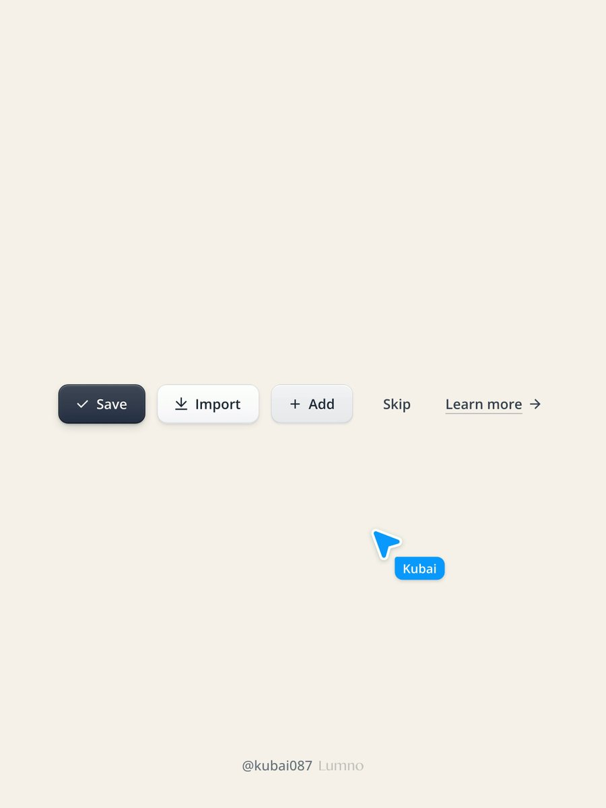

# 001 富有点击手感的拟物按钮

| 项目 | 内容 |
| --- | --- |
| 期号 | 001 |
| 发布时间 | 2026-10-25 23:29（北京时间） |
| 作者 | 枯白啃设计 [@Kubai087](https://x.com/Kubai087) |
| 原帖 | [https://x.com/Kubai087/status/2114378773655326873](https://x.com/Kubai087/status/2114378773655326873) |
| 提示词位置 | 提示词写在主帖正文里。 |

## 作者讲了什么

作者这一期没有另写中文讲解，正文直接给出提示词。下面是整理者根据提示词写的要点：

- 一套有真实按压手感的拟物按钮，从强到弱五种：primary、secondary、tertiary、ghost、text。
- 只用中性灰，光从正上方打下来，不要高光、发光和大面积模糊。
- 每个按钮由五层材质叠成：表面渐变、1px 描边、顶部高光、底部暗线、两层投影。
- 按下时整体下移 1px，渐变上下翻转，投影收起，像按进纸面的按键。
- 所有尺寸按字号等比缩放，提供 md（14px 字）和 lg（16px 字）两档。

## Prompt

以下是作者给出的原文提示词，可直接复制给 AI。纯文本版见 [prompt.md](prompt.md)。

````text
Define a tactile, skeuomorphic Button component with five variants, from
strongest to weakest: primary, secondary, tertiary, ghost, text.
If the project already has a component library or design system, do not
add a new component: restyle its existing Button through its own variant
and token system, and keep its API, props and accessibility as they are.
Otherwise create one reusable Button with `variant` and `size` props.

Style: calm and precise, like the Lumno browser extension and the Cloudflare
dashboard. Neutral grays only, no brand hues. Lit from straight above.
No glossy Web 2.0 shine, no glow, no large blur.

Variants:
1. primary   - near-black slate face (#404859 -> #273042), white label
2. secondary - raised white key (#FFFFFF -> #F4F5F7), dark gray label
3. tertiary  - soft gray key (#F3F4F6 -> #E7E9EC), dark gray label
4. ghost     - no face at rest; faint gray fill on hover; a recessed well
               when pressed
5. text      - gray label with a thin underline and an arrow that nudges
               right on hover

Every filled variant is the same five material layers; only the values
change, so define them once as tokens and let each variant set its own:
1. Face: 180deg linear gradient, top 6-8% lighter than bottom.
2. Edge: 1px solid border one step darker than the bottom of the face
   (primary #12161F, secondary rgba(15,23,42,.14), tertiary rgba(15,23,42,.1)).
3. Top highlight: inset 0 1px 0 white (18% on slate, 85-100% on light
   faces). Put every inset layer in the button's own box-shadow, before the
   drop layers, never on a pseudo-element overlay: inset shadows on the
   element follow the inner radius (outer radius minus border), so the
   corners line up in every state.
4. Bottom shade: inset 0 -1px 0 black (22% on slate, 6% on light faces).
5. Drop shadow in two layers: a tight contact shadow 0 1px 2px plus a soft
   lift 0 4px 10px -3px (18% and 28% on slate, about a third of that on
   light faces).

States (hover, pressed/active, focus-visible, disabled):
- Hover: face one step lighter; the lift grows to 0 8px 16px -5px.
- Pressed: translateY(1px); flip the gradient (darker on top); the outer
  shadow collapses to 0 1px 1px; the top highlight becomes an inner shadow,
  inset 0 1px 2px black (40% on slate, 12-16% on light faces). Light faces
  keep a 1px white line below, 0 1px 0 rgba(255,255,255,.9), like a key
  pressed into paper.
- Give rest and pressed the same number of inset layers (pad with
  inset 0 0 0 transparent) so the shadow animates instead of jumping.
- Focus-visible and disabled follow the library's existing conventions.
- Timing: 120ms for transform, 140ms for shadows, 160ms for colors.

Sizes: all values above are for the 14px label size: height 40px,
padding 0 18px, radius 10px, label weight 600, optional 16px leading icon.
On the slate face add a label text-shadow 0 -1px 0 rgba(0,0,0,.28).
Scale the material with the type, never keep it at fixed pixels: express
every length (height, padding, radius, border, icon, the 1px press offset,
and every shadow offset, blur and spread) as a multiple of a size unit
u = label size / 14. Provide two sizes: md (14px label, u = 1px) and
lg (16px label, u = 16/14 px, so height 45.7px, radius 11.4px, lift shadow
0 4.6px 11.4px -3.4px).
````

## 效果



<video src="media/demo.mp4" poster="media/poster.jpg" controls muted width="360"></video>

如果上面的视频没有显示，直接打开 [media/demo.mp4](media/demo.mp4)。
