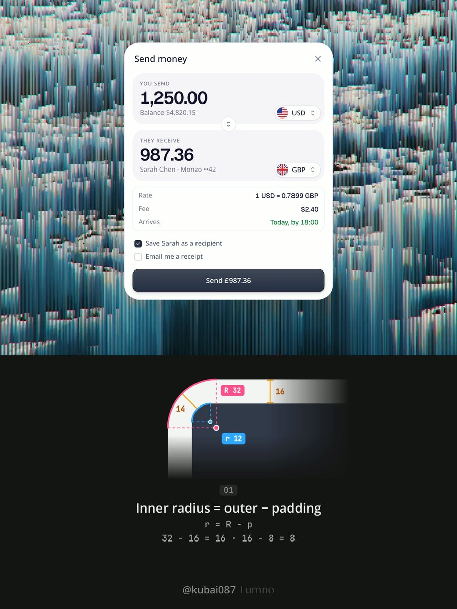

# 004 使用递进式圆角数值 + 连续曲率圆角（超椭圆）

| 项目 | 内容 |
| --- | --- |
| 期号 | 004 |
| 发布时间 | 2026-10-28 23:44（北京时间） |
| 作者 | 枯白啃设计 [@Kubai087](https://x.com/Kubai087) |
| 原帖 | [https://x.com/Kubai087/status/2115469767650021796](https://x.com/Kubai087/status/2115469767650021796) |
| 提示词位置 | 提示词写在主帖正文里。 |

## 作者讲了什么

要点一：等距内缩。当你想让表单、嵌套卡片的各种元素看起来更规整的时候，使用递进式圆角。保证每一层都遵守：

内圆角 = 外圆角 − 间距，内外共用一个圆心

要点二：连续圆角/超椭圆。普通圆角接直边的地方有一道折痕，连续圆角过渡更顺（类比 iOS）：

border-radius: 32px
corner-shape: superellipse(1.25)

Chrome / Edge 139+ 支持；Safari、Firefox 暂不支持，会自动退回普通圆角。

## Prompt

以下是作者给出的原文提示词，可直接复制给 AI。纯文本版见 [prompt.md](prompt.md)。

````text
Make the corner radii in this UI consistent, then switch them to continuous corners. Work on the screen or components I name; ask me if I have not named them. If the project has radius tokens, change those instead of hard-coding values.

Inner radius = outer radius - padding (r = R - p)
Go from the outside in: dialog or card -> panels, inputs, buttons -> chips and tags. A box p inside a container with radius R gets R - p, so both corners share one center. Example: dialog 32, padding 16 -> panels and buttons 16; a chip 8 inside a 16 panel -> 8.
Boxes on the same level share one radius. Never go below 4.

Pills and circles stay fully round.
Keep every padding, gap and radius on a 4px grid.
Continuous corners
Keep border-radius and add the curve as progressive enhancement: @ supports (corner-shape: superellipse(1.25)) { :where(*) { corner-shape: superellipse(1.25); } } Set corner-shape: round on pills and circles.

Chrome and Edge 139+ render it; Safari and Firefox skip the block and show the plain border-radius.
When done, list every radius you changed as "element: old -> new".
````

## 效果



<video src="media/demo.mp4" poster="media/poster.jpg" controls muted width="360"></video>

如果上面的视频没有显示，直接打开 [media/demo.mp4](media/demo.mp4)。
