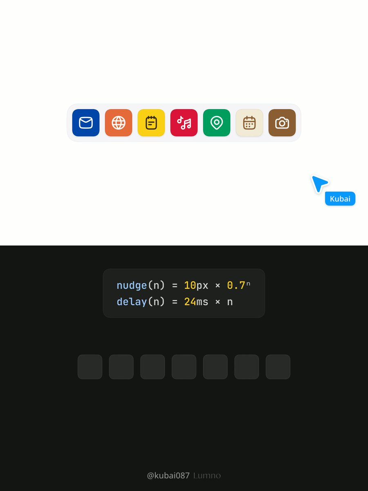

# 005 更灵动的拖拽排序

| 项目 | 内容 |
| --- | --- |
| 期号 | 005 |
| 发布时间 | 2026-10-29 23:10（北京时间） |
| 作者 | 枯白啃设计 [@Kubai087](https://x.com/Kubai087) |
| 原帖 | [https://x.com/Kubai087/status/2115823717024735708](https://x.com/Kubai087/status/2115823717024735708) |
| 提示词位置 | 提示词写在主帖正文里。 |

## 作者讲了什么

做横向或纵向的拖拽排序时，让落点两侧的元素轻轻让开，并且由近及远依次启动，动作会更像真实世界里的推挤。

要点：
1. 光标及时反馈：悬停时变成手指，按下时变成抓手；
2. 落点用一条插入线提示：出现时从中间轻轻展开，拖动时跟着移到新的落点；
3. 插入线两侧的元素向外避让，离得越近，让得越多、动得越早：
位移 = 10px × 0.7ⁿ
延迟 = 24ms × n
（n 是与插入线相隔的层数，紧挨着的为 0）

## Prompt

以下是作者给出的原文提示词，可直接复制给 AI。纯文本版见 [prompt.md](prompt.md)。

````text
Make drag-to-reorder in my product feel like this. Apply it to the lists,
rows and docks I name, and reuse any drag helper the project already has.

1. Cursor: a pointing hand over anything draggable, a grabbing hand while
   dragging.
2. Lift: the picked item follows the pointer, raised off the list so it
   never hides where it will land: above a horizontal row, or pulled aside
   and shrunk to about 90% in a vertical list. Its old slot closes up.
3. Drop hint: a faint, thin line in the gap where it will land (vertical in
   a row, horizontal in a list), about 15% of the text color. It grows from
   its middle when it appears and glides to each new gap. No line over the
   item's own slot.
4. Ripple: items on both sides of the line lean away from it. Counting n
   from the line (0 = the item touching it), item n moves
   A x 0.7^n (A is about 10px for icons, 8px for cards)
   and starts 24ms x n later, on a quick spring that barely overshoots and
   settles in about 0.25s. Nearer items move sooner and further, so the
   push spreads out like a ripple.
5. Drop: the item takes the gap and every item springs into its new place.
   Escape or dropping outside the list cancels, and everything springs back.
6. Give each motion its own curve (hand-like for the pointer, a small pop
   for the lift, springs for settling) instead of one ease-out everywhere.

Move things with transforms, not layout. Let the keyboard reorder too, and
with reduced motion keep only the line.
````

## 效果



<video src="media/demo.mp4" poster="media/poster.jpg" controls muted width="360"></video>

如果上面的视频没有显示，直接打开 [media/demo.mp4](media/demo.mp4)。
