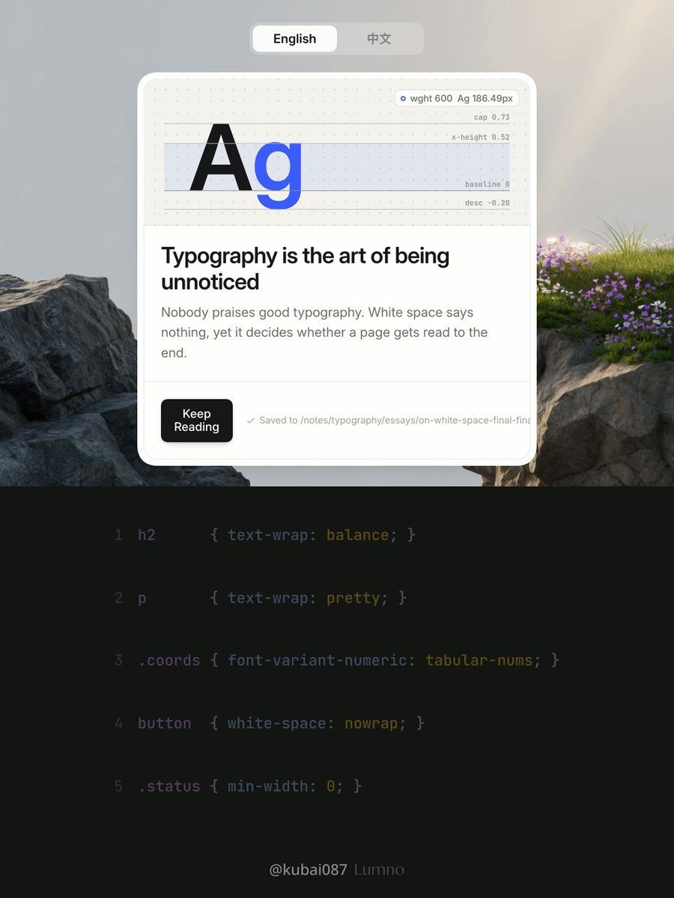

# 007 让你的文字排版更顺眼（以中英文为例）

| 项目 | 内容 |
| --- | --- |
| 期号 | 007 |
| 发布时间 | 2026-10-31 23:37（北京时间） |
| 作者 | 枯白啃设计 [@Kubai087](https://x.com/Kubai087) |
| 原帖 | [https://x.com/Kubai087/status/2116555064227811412](https://x.com/Kubai087/status/2116555064227811412) |
| 提示词位置 | 提示词写在作者自己的回复里：[2116555520274493582](https://x.com/Kubai087/status/2116555520274493582)。 |

## 作者讲了什么

不论是英文，还是中文，都需要解决对齐、长度不均，避头尾问题。你可以通过一些简单的 CSS 来进行处理——

更重要的是，在做 i18n 的时候，让 Agent 结合网页布局选择合适的文本。避免一个词居于两行，也避免过多的空隙。

## Prompt

以下是作者给出的原文提示词，可直接复制给 AI。纯文本版见 [prompt.md](prompt.md)。

````text
Polish the typography in my product with a set of CSS switches. Change only how text wraps, spaces, aligns and truncates. No copy, font, colour or layout changes beyond what each rule says.

0. Start from what exists
- Put the rules in the global text styles (base CSS, typography tokens, Tailwind config or shared text components) so every page inherits them. Add per-component rules only where a component overrides the base.
- Every rule below is progressive enhancement: browsers that don't know a property ignore it. Add no polyfills.
- Scope the Chinese rules with :lang(zh), and make sure the lang attribute is set on the html element or on the element itself, so English text keeps its own rules.

1. Headings break into even lines
- On h1 to h3, card titles and hero lines: text-wrap: balance;
- Lines come out about the same length, so a heading never ends on one lonely word. Short text only: Chrome balances up to 6 lines.

2. No lone word at the end of a paragraph
- On paragraphs, descriptions and list items: text-wrap: pretty;
- Also join pairs that must not split with a non-breaking space (U+00A0): an em dash and the name after it, a number and its unit.

3. Numbers that change keep their width
- On anything that updates in place or sits in a column (counters, prices, timers, stats, table cells): font-variant-numeric: tabular-nums;
- The font must have tabular figures (the tnum feature); check that the width actually stops changing. Leave running text proportional.

4. Button labels stay on one line
- On buttons and other labels in flex rows: white-space: nowrap; (flex-shrink: 0 works too)
- A crowded row must not squeeze a label onto two lines.

5. Long text truncates instead of spilling out
- A flex item won't shrink below its content, so text inside it can't truncate. On the flex item: min-width: 0;
- On the text itself: overflow: hidden; white-space: nowrap; text-overflow: ellipsis;
- When the text really is cut (scrollWidth > clientWidth), show the full text in a tooltip on hover.

6. Chinese body text: justified, on a whole number of characters
- On Chinese paragraphs only: text-align: justify;
- Set the measure to a whole number of characters (for example max-width: 26em at the paragraph's font size), so a justified line only stretches to absorb Latin words and squeezed punctuation.
- Not for narrow columns (under about 15 characters), short text, captions, buttons or mostly-English text: the gaps get uneven.

7. Space between Chinese and Latin text or numbers
- On Chinese text: text-autospace: normal;
- The browser adds a thin gap between Han characters and Latin letters or digits. Don't also hand-type spaces in copy or translation files. Skip code, inputs and monospaced text.

8. No half-width gap before an opening bracket at a line start
- On Chinese UI text without a first-line indent: text-spacing-trim: trim-start;
- An opening 「 “ （ at the start of a line drops its blank half and lines up with the text above. Long-form text with a two-character indent should use space-first instead. Chrome only for now.

9. Chinese headings break between words
- Chinese has no spaces, so a heading can split a word across lines. Mark the break points between words with BudouX (its Simplified or Traditional Chinese model), inserting a wbr element at each one, at build time for static copy or at render time for dynamic copy. Then: word-break: keep-all; overflow-wrap: anywhere; text-wrap: balance;
- Never use keep-all on Chinese without break points: the heading becomes one unbreakable word. Don't use Intl.Segmenter for this (it splits common words wrongly), and don't apply it to body text.

10. Line-start and line-end rules (避头尾)
- Browsers already keep punctuation off the start of a line and squeeze line-end punctuation. Don't rebuild this.
- Find and remove any line-break: anywhere used to stop overflow: it turns these rules off. Use overflow-wrap: anywhere instead.
- Text drawn on canvas or SVG, or wrapped by hand in JS, gets none of this: apply the rules there yourself.

11. When done
- List every file and selector you changed.
- List every line-break: anywhere and word-break: break-all you removed or kept, and why.
- Show before and after on my own pages: a wrapped heading, a paragraph ending, a changing number, a truncated label and a mixed Chinese-English paragraph.
````

## 效果



<video src="media/demo.mp4" poster="media/poster.jpg" controls muted width="360"></video>

如果上面的视频没有显示，直接打开 [media/demo.mp4](media/demo.mp4)。

## 补充说明

作者在回复里说明：视频里的背景图来自 @uixhassan 的免费素材库。原回复：https://x.com/Kubai087/status/2116566308406145251
