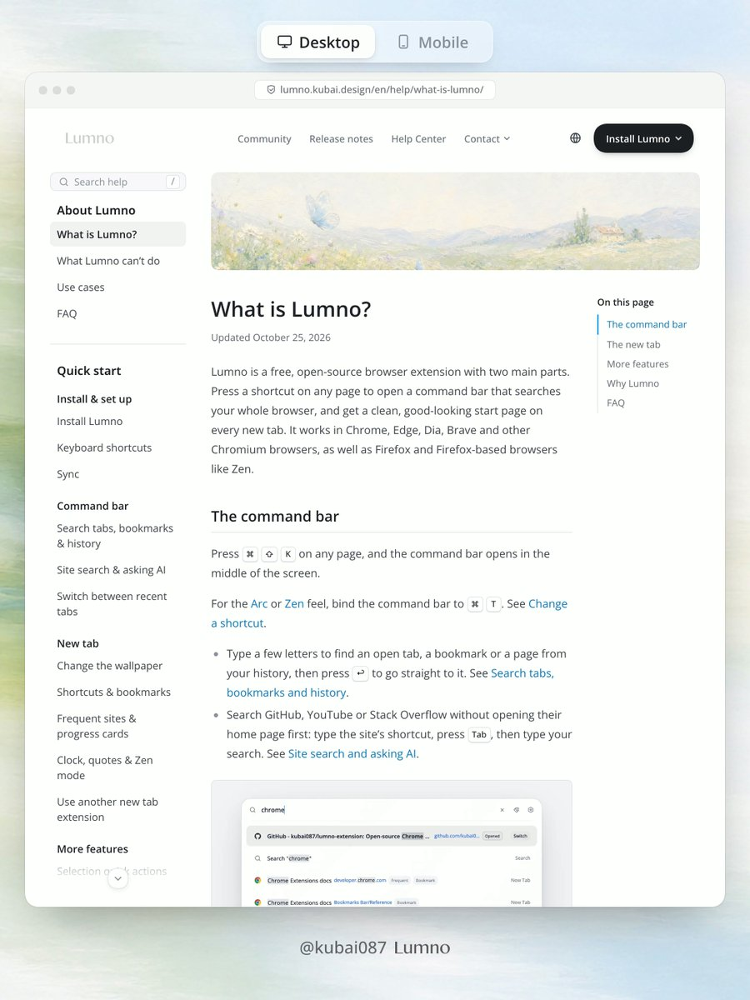

# 008 如何设计 Wiki 的框架和布局，兼顾 PC 和移动端体验？

| 项目 | 内容 |
| --- | --- |
| 期号 | 008 |
| 发布时间 | 2026-11-01 23:13（北京时间） |
| 作者 | 枯白啃设计 [@Kubai087](https://x.com/Kubai087) |
| 原帖 | [https://x.com/Kubai087/status/2116911391437443471](https://x.com/Kubai087/status/2116911391437443471) |
| 提示词位置 | 提示词写在作者自己的回复里：[2116917025348231369](https://x.com/Kubai087/status/2116917025348231369)。 |

## 作者讲了什么

当产品开始变复杂，或者官网需要写大量 SEO 文章时，一套可靠的 Wiki 页面既能快速解答用户疑问，也能带来 SEO 流量。

那么：
Q1：移动端怎么优雅地切换章节？
Q2：章节导航太多，超出一屏怎么办？
Q3：文末引导有什么意义？
Q4：Footer 为什么应该超过半屏高？
Q5：导航栏的信息结构怎么安排？

A1：移动端以直板机为主，屏幕大多较窄。可以在底部常驻一个菜单栏，点开后用满屏菜单展示章节。一行一个，方便点击。

A2：导航用独立高度，和正文分开，超出部分上下截断。截断的边缘务必加渐变遮罩，让用户知道上下还有内容；再配一个居中的箭头按钮，便于点击。

A3：不管是人还是 AI 来读，在一篇解答问题的文章下面附上社群、社媒账号按钮，都能快速带来转化。卡片样式记得贴近正文组件，看起来更原生。这相当于为你的转化目标免费投了一则“上下文广告”。

A4：用好看的背景图撑高页脚，吸引用户滑到底并停留。再放上足够有用的信息，真正帮用户解决问题，才不会招人反感。

A5：LOGO（返回官网）+ 关键页面下拉菜单 + 核心 CTA 按钮，滚动时保持吸顶。注意 Safari 等浏览器会根据导航栏颜色给地址栏着色，导航栏背景色要和品牌协调。

## Prompt

以下是作者给出的原文提示词，可直接复制给 AI。纯文本版见 [prompt.md](prompt.md)。

````text
Polish the layout of my docs or help center pages: the header, the page list, the outline and the end of each article. Keep the content, copy, colours and fonts. Change only how these parts sit, scroll and respond.

0. Start from what exists
- Find the shared docs layout, the site header, the page list (sidebar), the outline (table of contents) and the footer. Change those, so every page inherits the result.
- Use CSS and a little plain JS. Add no scroll or animation libraries.

1. Think of the page as three layers
- The article and the footer scroll with the page.
- The page list and the outline are position: sticky. They stop where they start, so they never jump when scrolling begins, and the end of the layout pushes them up at the bottom.
- The header becomes position: fixed only after the page's opening (banner or hero) has left the screen. Before that it belongs to the page and scrolls away with it.

2. Header: it scrolls away, then comes back floating
- At the top it is clear, with no background.
- Once the reader has scrolled and the banner's bottom edge is at or above the top of the screen (getBoundingClientRect().bottom <= 0), show it as a floating bar: position: fixed; a translucent white background; backdrop-filter: blur(18px); a soft shadow.
- It enters in 320ms ease-out, from translateY(-24px) with blur(8px) and opacity 0. It leaves in 120ms when the reader scrolls back up to the banner. If the reader scrolls down again during the exit, cancel it and keep the bar.
- Give headings a scroll-margin-top so anchor links never land under the bar.

3. Page list: it scrolls on its own, and shows where there is more
- Hide its scrollbar and let it scroll by itself.
- Fade an edge only while more of the list waits beyond it. Toggle data-more-above and data-more-below on scroll and resize, and drive a mask-image: linear-gradient(...) with them: about 40px at the top and 56px at the bottom, each with a short fully clear strip at the very edge, so a half-cut row never shows as a faint line.
- Add a small round arrow on each edge that has more. A click scrolls the list by 60% of its visible height, smoothly. Arrows are for the mouse only (tabindex="-1", aria-hidden="true"); keyboard focus already scrolls the list.
- On load, bring the current page into view. Keep the list's scroll position in sessionStorage, so moving to another page does not reset it.
- If there is a search box, let "/" focus it.

4. Outline: mark the section being read
- The current section is the last heading above a line 20% down the viewport.
- Mark its link with aria-current="location" and style that: border-left-color and text in the accent colour.
- Update it on scroll, at most once per animation frame.

5. End of the article: help first, then the next page
- If the reader is still stuck, a "Still need help?" card with one or two real channels (the issue tracker, the community, a contact).
- Then previous and next links, with each page's title. The first page links back to the home page.
- Then the footer.

6. Narrow screens
- Hide the outline on tablets and the page list on phones. Put both in one bar fixed at the bottom: the page list on its left half, the outline on its right half.
- The right half shows the name of the section being read, updated by the same 20% line, and truncated with an ellipsis when it is long.
- A tap on either half opens its list as a sheet from the bottom edge (a dialog opened with showModal()), sliding up 24px as it fades in, with no dimming behind it. Mark the current entry and scroll it into view (scrollIntoView({ block: "center" })).
- A tap on an entry, the close button, outside the sheet or Esc closes it; a section link then scrolls to its heading.
- Make the tap targets one size up from the desktop list.

7. Motion
- Under prefers-reduced-motion: reduce, turn off smooth scrolling and the header's enter and exit animations.

8. When done
- List every file and selector you changed.
- Check four states on my own pages: the top of a page, the middle, the end, and a phone-width window.
- Show a screenshot of each.
````

## 效果



<video src="media/demo.mp4" poster="media/poster.jpg" controls muted width="360"></video>

如果上面的视频没有显示，直接打开 [media/demo.mp4](media/demo.mp4)。
