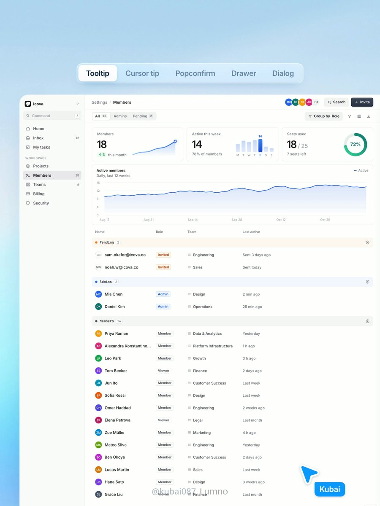

# 009 提示框、跟随气泡、就地确认、抽屉与弹窗，到底怎么选？

| 项目 | 内容 |
| --- | --- |
| 期号 | 009 |
| 发布时间 | 2026-11-03 01:53（北京时间） |
| 作者 | 枯白啃设计 [@Kubai087](https://x.com/Kubai087) |
| 原帖 | [https://x.com/Kubai087/status/2117314098165862612](https://x.com/Kubai087/status/2117314098165862612) |
| 提示词位置 | 提示词写在作者自己的回复里：[2117314198430757283](https://x.com/Kubai087/status/2117314198430757283)。 |

## 作者讲了什么

Q1：提示框和跟随气泡，区别在哪？
Q2：操作要让用户确认，怎样才不打扰？
Q3：表单该放进弹窗、抽屉，还是单独一页？

第 1 点
提示框（Tooltip）为光标所指的内容补充文字，常见于被折叠的长文本；要放操作，就改用点击打开的气泡（Popover）。

跟随气泡（Cursor tip）在一块区域内持续提供信息：光标移入才出现，并跟着光标走，常见于图表和相对独立的元素。到了手机上，两者都改成点击显示。

第 2 点
能撤销的操作，直接执行，再留一个「撤销」入口。

不可逆的操作才需要二次确认：大多数情况用就地确认（Popconfirm），路径短，也不打扰；影响大、批量操作，或必须让用户停下来的，再用弹窗（Dialog）。

第 3 点
表单短、不需要参照界面上的其他信息，用弹窗；
表单长、需要对照界面内容，或想更好地利用横向空间，用抽屉；
本身就是主要任务的，做成独立页面。

## Prompt

以下是作者给出的原文提示词，可直接复制给 AI。纯文本版见 [prompt.md](prompt.md)。

````text
Review how my product uses floating UI (tooltips, tooltips that follow the pointer, popovers, popconfirms, drawers and dialogs) and decide which kind each case should be. Work inside my existing design system. This is about choosing the right kind, not about restyling: keep my components, colours, radii, shadows, fonts, motion and copy style.

0. Start from what exists
- Find every overlay in the product and the components behind it: tooltips, hover cards, popovers, confirm bubbles, menus that confirm, side panels, drawers, sheets, modals and dialogs.
- For each use, note where it is, what opens it, what it holds and what happens when the user confirms.
- Find the design system's own component for each kind. Reuse it. If two components do the same job, say so and suggest which one to keep.

1. What each kind is for
- Tooltip: adds text about what the pointer is on, such as long text that has been cut short, an icon-only button or a disabled control. Text only. If it needs actions, it becomes a popover opened by a click.
- Tooltip that follows the pointer: keeps giving information across an area. It appears when the pointer enters, follows it, and goes when the pointer leaves. Common on charts and on other self-contained elements.
- Popconfirm: the second check for an irreversible action on a single item, right where it was clicked. The path stays short and nothing else is interrupted.
- Dialog: for something the user must stop and confirm or complete before going on: an action with a large impact, one that affects other people, a bulk action, or one that needs another decision first (such as who takes over the projects). Also for a short form that doesn't need anything else on the page for reference.
- Drawer: for a long form, for work that needs the page in view to compare against, or to make better use of horizontal space. Never use a drawer to confirm something.
- Full page: when the task is the user's main job there, or it needs a link that can be shared and survives a reload.

2. Questions that settle a case
- Can the action be undone? Then don't confirm: do it at once and offer Undo (a toast, or a way back such as a trash).
- If it can't: is it one item of the user's own, with a button to anchor to? Popconfirm. Large impact, other people, a bulk selection, or a decision still to make? Dialog.
- Is it a form? Short, and nothing on the page is needed for reference: dialog. Long, needs the page in view, or wants the width: drawer. The main task, or needs its own URL: a page.
- Is the information about one element, or about wherever the pointer is inside an area? One element: tooltip. An area: tooltip that follows the pointer. Either way, does it need anything to click? Then it is a popover.
- On touch screens there is no hover: anything shown on hover must also be reachable by a tap.

3. What each kind should do
Fill in only what is missing, with the design system's existing parts.
- Tooltip: shows on hover and on keyboard focus, after about 500ms for the first one, then at once when moving to a neighbour. Stays inside the viewport, lets the pointer through, one at a time, linked with aria-describedby.
- Tooltip that follows the pointer: sits beside the pointer without covering it and flips near the edges of the viewport. On a chart, the guide line follows the pointer and the value snaps to the nearest data point. On touch, a tap shows the value.
- Popconfirm: anchored to the button that opened it and grows from it. Escape or a click outside closes it, and focus goes back to that button. The confirm button names the action.
- Dialog: the system's modal or a native dialog opened with showModal(). Keeps focus inside and Escape cancels. It says who or what is affected and what cannot be undone. Buttons name the action ("Remove member", not "OK").
- Drawer: comes in from the edge it is attached to and leaves the page in view. Changes show up in the page behind it as they are made. Closes with Escape and a close button; focus moves into it and back out to what opened it.
- Drawers, dialogs and pages with a form: closing with unsaved changes asks first.

4. Keep the design as it is
- Change only the kind where the current one is wrong, plus the missing behaviour from step 3.
- Don't change colours, radii, shadows, fonts, spacing or animations, and don't add new visual patterns.
- Keep copy as it is, except confirm buttons and the line that explains what cannot be undone.
- If a case needs a component the system doesn't have (an undo toast, a popover), stop and ask me before adding one.

5. Deliver the decisions first
- Before changing any code, give me a table: each use, where it is, its current kind, the kind you recommend, and why in one line.
- Mark the ones that are already right, and the ones that could fit two kinds, with what decides between them.
- Wait for my go-ahead, then make only the changes I approve and list every file you touched.
````

## 效果



<video src="media/demo.mp4" poster="media/poster.jpg" controls muted width="360"></video>

如果上面的视频没有显示，直接打开 [media/demo.mp4](media/demo.mp4)。
