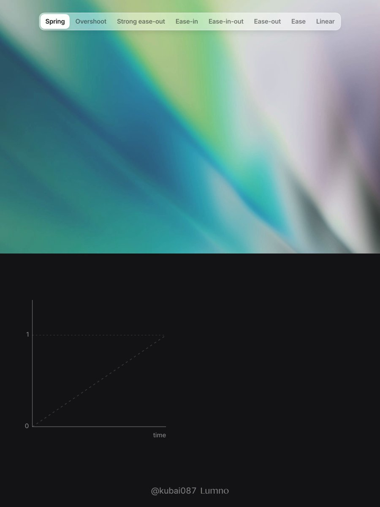

# 011 如何选择更合适的动画节奏？

| 项目 | 内容 |
| --- | --- |
| 期号 | 011 |
| 发布时间 | 2026-11-05 08:50（北京时间） |
| 作者 | 枯白啃设计 [@Kubai087](https://x.com/Kubai087) |
| 原帖 | [https://x.com/Kubai087/status/2118143759984803898](https://x.com/Kubai087/status/2118143759984803898) |
| 提示词位置 | 提示词写在作者自己的回复里：[2118143923571048817](https://x.com/Kubai087/status/2118143923571048817)、[2118144019545067872](https://x.com/Kubai087/status/2118144019545067872)。 |

## 作者讲了什么

在动画里，我们通常用速度曲线来描述节奏，其实很好理解：曲线越陡，速度变化越剧烈，视觉上就显得越「快」，反之亦然。

视频中用残影和曲线对照展示了这一过程。

做设计判断时，可以参考下面的规则，也可以直接把它讲给 AI：

Linear：匀速运动，起停都很生硬。适合进度条、加载这类看着只是「在跑」的东西。

Ease-out：快进、慢停。适合浮层和模态元素的入场，如 toast、菜单、弹窗、抽屉。

Strong ease-out：起步更猛、收尾更长，最跟手。适合点击后马上落位的小元素：图标、文字、选中的胶囊。

Ease-in：慢起、越来越快，干脆地离开。适合元素退场，比如弹窗关闭、toast 消失。

Ease-in-out：慢起、中间最快、慢停。适合原地换位置的元素：标签下滑动的指示条、轮播翻页、目录平滑滚动等。

Overshoot：冲过终点约 10% 再退回。适合小而俏皮的确认：勾选、点赞、角标弹出。避免在大面板上使用。

Spring：到位后轻晃一两下再停稳，比 Overshoot 更像真实物体。适合松手后的归位：抽屉回弹、下拉刷新、拖动排序落等。

## Prompt

以下是作者给出的原文提示词，可直接复制给 AI。纯文本版见 [prompt.md](prompt.md)。

````text
Prompt (1)

Give the motion in my product the right easing curves, so things arrive, leave and move the way they should feel. Work inside my existing code and design system: keep what each animation does, how far it goes and what triggers it. Change how it moves over time, and its duration where that is off.

0. Start from what exists
- Find every transition and animation: CSS transitions and keyframes, animation libraries (Framer Motion, GSAP, the Web Animations API) and hand-written requestAnimationFrame loops. List each with its component, its trigger, its duration and its curve.
- Flag the ones left on the CSS default `ease`, `linear` on something that moves, and `ease-in` on something that appears.

1. The curves as tokens
Define them once, next to the other motion tokens, and use only these:
- --ease-out: cubic-bezier(0, 0, .58, 1). Anything that enters: toasts, menus, popovers, dialogs, drawers.
- --ease-out-strong: cubic-bezier(.22, 1, .36, 1). Small parts settling in right after a click: an icon, a label, a selected pill. It feels the most responsive.
- --ease-in: cubic-bezier(.42, 0, 1, 1). Anything that leaves, and only that: a toast timing out, a dialog or drawer closing, a menu collapsing, a list item swiped away. It starts slow and leaves at full speed, so on an entrance it feels late and then stops with a bump.
- --ease-in-out: cubic-bezier(.42, 0, .58, 1). Something that stays on screen and only changes place or size: the indicator under tabs or a segmented control, a carousel turning a page, items making room during a reorder, a sidebar resizing, smooth-scrolling to an anchor. Not for coming in: its slow start reads as lag.
- --ease-overshoot: cubic-bezier(.34, 1.56, .64, 1). Runs about 10% past its place and comes back. Small, playful confirmations: a checkbox tick, a like, a badge count popping in, a switch knob settling. Never on a dialog, a drawer or anything larger than about 64px, and not on actions people repeat all day.
- --ease-spring: linear(0, .32, .78, 1.04, 1.09, 1.06, 1.02, 1, .99, .99, 1). Things let go after a drag or a swipe, so they settle like an object: a bottom sheet snapping open or back, a card returning after a half swipe, pull-to-refresh springing back, a reordered item dropping into place. Prefer the animation library's own spring fed with the release velocity; use this token only where there is none, and fall back to --ease-out-strong where linear() is not supported.
- linear: only for things that run rather than move: spinners, progress bars, marquees.
- The CSS default `ease` is not a choice. Replace it wherever a curve was left unset.

2. Durations
- Small UI (toasts, tooltips, menus, checks): 150-250ms in, 120-200ms out. Exits are shorter than entrances.
- Medium (dialogs, popovers with content, drawers): 250-350ms.
- Large or full-screen (sheets, page transitions): 350-500ms. Longer feels slow.
- Springs and overshoots: about 1.5x the plain duration, since the settle takes time.
- Keep the durations as tokens beside the curves (--duration-sm, -md, -lg).

3. Apply them by role
- Entrances: ease-out, coming from where the thing belongs (a toast from the top edge, a menu from its trigger), over a short distance (8-24px), growing from 96% and fading in a little sooner than it moves. A light blur (about 8px) that clears as it lands is a nice touch on toasts.
- Exits: ease-in, the same path reversed, and shorter.
- Moves on screen: ease-in-out.
- Parts inside something that has just appeared (its icon, its text, a count) may follow 100-200ms later on the strong ease-out, so it lands in steps rather than all at once.
- Gestures: while the pointer or finger moves, follow it 1:1 with no easing. On release, finish on the spring, from the release velocity if the library allows.
- Hover and press: 100-150ms ease-out. Never animate layout on hover.
- Animate transform and opacity (filter sparingly), not top, left, width or height, which lay out and repaint every frame.

Prompt (2)

4. Keep it consistent and accessible
- One curve per role across the product. Don't tune each component by hand.
- Respect prefers-reduced-motion: keep the opacity changes, drop movement and scale, and turn springs and overshoots into a plain 150ms fade.
- Never make a user wait on an animation: nothing blocks input, and a new action interrupts the old animation from where it is.

5. Deliver
- First list every animation you found, its current curve and duration, and the role and curve you will give it.
- Then add the tokens, switch each animation over, and list every file you touched.
- Don't change what animates, how far it goes or what triggers it. If an animation has no clear role, ask me first.
````

## 效果



<video src="media/demo.mp4" poster="media/poster.jpg" controls muted width="360"></video>

如果上面的视频没有显示，直接打开 [media/demo.mp4](media/demo.mp4)。
