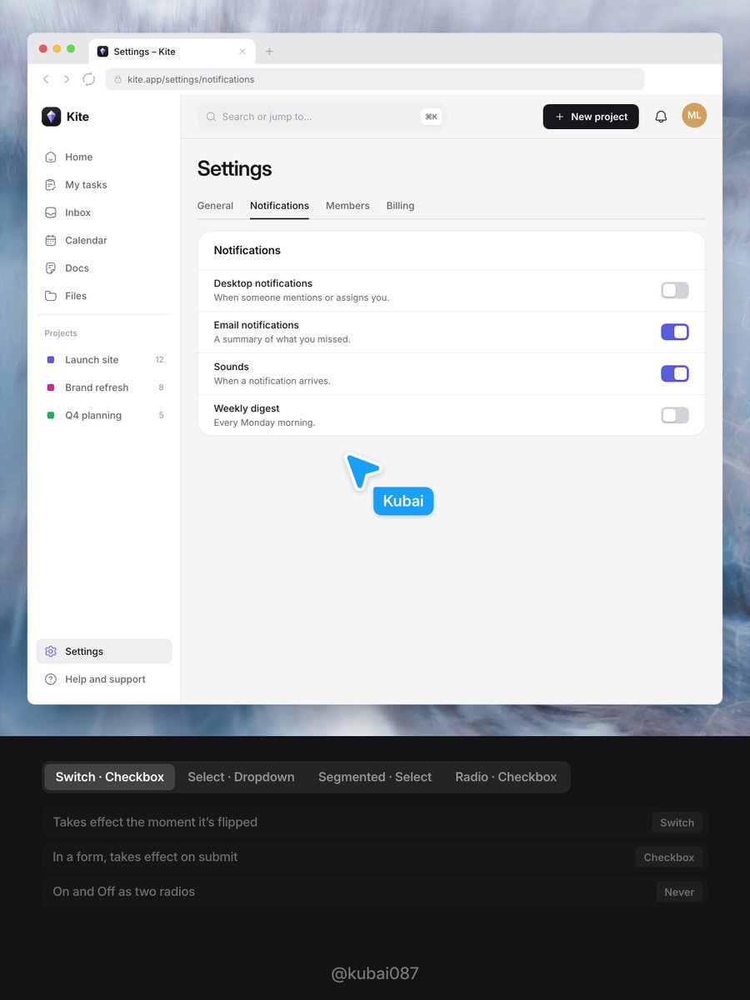

# 020 开关、复选框、单选和下拉，怎么选？

| 项目 | 内容 |
| --- | --- |
| 期号 | 020 |
| 发布时间 | 2026-11-19 08:50（北京时间） |
| 作者 | 枯白啃设计 [@Kubai087](https://x.com/Kubai087) |
| 原帖 | [https://x.com/Kubai087/status/2123217190052827633](https://x.com/Kubai087/status/2123217190052827633) |
| 提示词位置 | 提示词写在作者自己的回复里：[2123219668165140511](https://x.com/Kubai087/status/2123219668165140511)。 |

## 作者讲了什么

今天分享几个基础控件的使用场景，并附一条诊断提示词，帮你找出项目中的类似问题，可以直接复制使用。

- 开关（Switch）与复选框（Checkbox）：核心区别在于何时生效。开关拨动后立即生效，适合设置页等非表单场景；复选框通常随表单一起提交，需要搭配保存按钮。一件事的开与关应当用一个开关表示，而不是两个单选（Radio）。
- 下拉选择（Select）与下拉菜单（Dropdown）：外观相似，承载的内容却不同。下拉菜单里是动作，点击后立即执行，常用于收纳工具栏或页面顶部的按钮；下拉选择里是数值、状态或选项，选中后显示在输入框中，比如语言选择。下拉菜单也常以图标按钮作为触发器，与主按钮并排放置，收纳其他相关操作，比如“发送”旁边的“定时发送”“存为草稿”。
- 分段选择（Segment）与下拉选择（Select）：两者都用于单选。2–5 个简短的选项，适合用分段选择，所有选项一目了然；如果选项更多、文字较长，或者选项的值并不固定，就应改用下拉选择，以免内容变化导致界面跳动。选项特别多时，可以在菜单列表顶部加一个搜索框，并做好没有结果时的空状态。
- 单选（Radio）与复选框（Checkbox）：单选适合问卷这类需要列出全部选项的单选题。由于选中之后无法取消，最好提供“暂不确定”之类的选项。允许选择多项时，则使用复选框。下拉选择中也是如此：单选时不用单选圆圈，而是在选中项后打勾；多选时在每一项前加复选框。

作者附了一条诊断提示词：它会先读取你的产品，判断每个选择控件是否用对，列出表格由你决定；你确认后，再按你的组件去做修改。

## Prompt

以下是作者给出的原文提示词，可直接复制给 AI。纯文本版见 [prompt.md](prompt.md)。

````text
Prompt

Review the choice controls in my product (switches, checkboxes, radio buttons, segmented controls, selects and dropdown menus) and decide for each one whether it is the right control. Diagnose first; change only what I approve, in my own code and components, without new dependencies.

1. Read the product
Find every place a person picks something, turns something on or off, or runs an action from a list. For each, note what it sets or does, how many options it has, how many can be picked, and whether it takes effect at once or on Save.

2. How to choose
a. Switch or checkbox: when it takes effect.
- Switch: takes effect the moment it is flipped (settings that save on their own, no Save button).
- Checkbox: one answer in a form, applied on Submit or Save.
- One thing on or off is one switch, never two radios (On / Off). If both sides have names of their own (Light / Dark), it is a choice of one: see (c).

b. Select or dropdown menu: a value or an action.
- Select: holds a value; after a pick the field shows it, and the picked option has a tick in the list.
- Dropdown menu: holds actions (Export, Duplicate, Delete). A pick runs it, the button keeps its name, and the result shows elsewhere. Menus go in page headers, toolbars and row ends, not among form fields. A split button pairs a main action with a menu of related ones (Send, with Send later and Save as draft beside it).
- Tabs switch to other content and set nothing; a segmented control sets a value or the view of the same content.

c. One of several: by the number of options.
- 2 to 5 short options: a segmented control.
- 2 to 5 that each need a line: radio buttons, stacked under the label.
- 6 or more, or labels that change or grow (names, dates, items people add): a select, so the layout never shifts.
- Hundreds (time zones, countries, people): a select with search, and a clear message when nothing matches.

d. Radio or checkbox: how many can be picked.
- Radio: exactly one, all options in view, as in a survey question. It can't be cleared once picked, so add a "none" option (Not sure yet) when that is a fair answer.
- Checkbox: any number, none included.
- Inside a select: a tick for one value, never radio circles; a checkbox before each option for several, with the picks shown as chips in the field.

3. Report before changing
Give me a table, one row per control: where, what it sets or does, the control now, the control it should be (or "right as it is"), why in one line, and anything else that changes (a Save button, a "none" option, an action moved out of a form). Flag every change in behaviour, ask about cases that could go either way, and wait for me to choose.

4. Change what I approve
Use my components, or the platform's own controls when I have none. Keep the values people already saved. Check that switches act at once and checkboxes on submit, selects show their value, menu buttons keep their name, and everything works by keyboard and screen reader.
````

## 效果



<video src="media/demo.mp4" poster="media/poster.jpg" controls muted width="360"></video>

如果上面的视频没有显示，直接打开 [media/demo.mp4](media/demo.mp4)。
